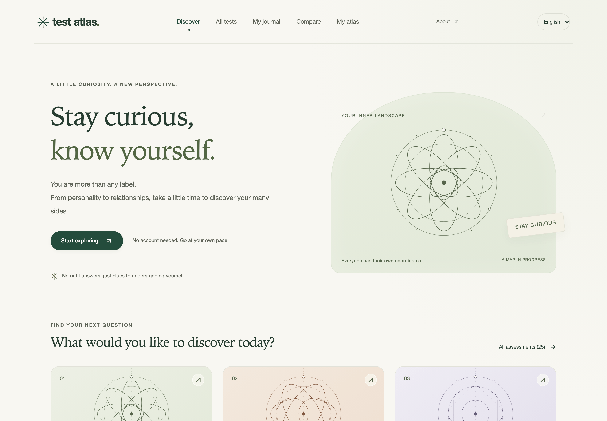
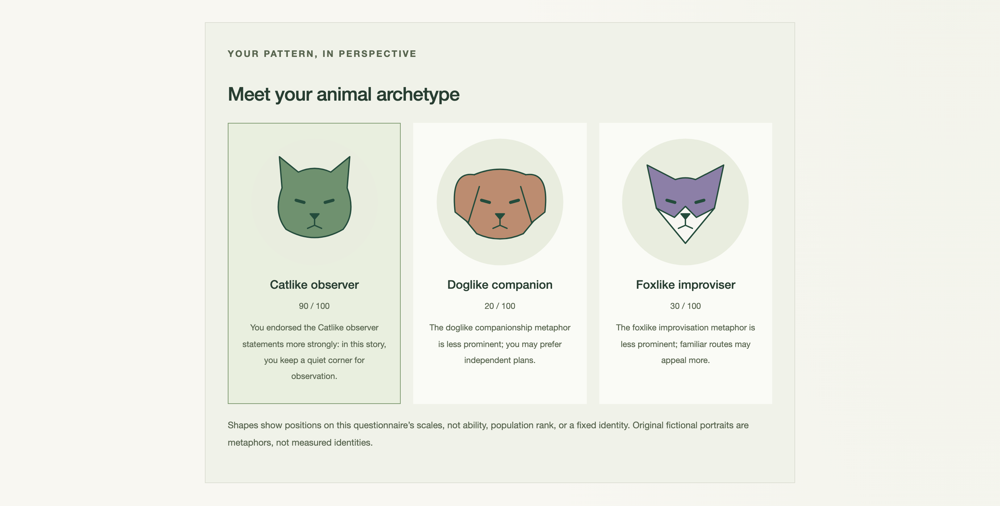

# Test Atlas

A little curiosity. A new perspective.

Explore personality, relationships, everyday habits, and career interests through 25 self-discovery assessments. Take your time, revisit your results, and start a thoughtful conversation with someone you care about.

**[Explore Test Atlas](https://octopusgarage.github.io/test-atlas/)**

[](docs/images/home.png)

## What you can do

- Find an assessment by topic, category, or name.
- Pause and resume without an account.
- Read topic-specific reports with contextual trade-offs, two everyday scenarios, reflection questions, and a seven-day action experiment.
- See personality radar charts, a motivation wheel, a 24-strength profile, an interest hexagon, social-energy batteries, and original illustrated characters.
- Build a personal exploration profile and revisit earlier results.
- Invite a friend through an optional score-sharing link, guess each other’s preferences, and try a friendly challenge.
- Make a two-person relationship map, choose a shared experiment, and download the report. Shared results must use the same assessment and content version.
- Explore occupation examples linked to O*NET, with practical ways to investigate them. Interests do not establish skills, qualifications, or employment prospects.
- Discover follow-up topics connected to your actual response pattern, with an explanation for each suggestion.
- Download a share card or voluntarily export a minimal result file. Answers stay out of shared files and links.
- Use the app in English or Simplified Chinese. English is the default.
- Install the app and explore offline after its resources are ready.
- Enjoy subtle page and question transitions that respect your reduced-motion preference.

[](docs/images/characters.png)

## Assessments

| Personality | Relationships | Everyday life & play | Work & growth |
| --- | --- | --- | --- |
| Big Five | Attachment tendencies | Social energy | Career interests |
| Nine motivations | Receiving care preferences | Animal archetypes | Work style |
| The shadow side | Romantic style | Imaginary villain archetypes | Career values |
| Character strengths | Conflict style | Hypothetical survival roles | Learning habits |
| Emotional habits | Personal boundaries | Online persona | Procrastination patterns |
| Six-factor exploration | Communication style | Spending preferences | Decision style |
| | | Playful psychological age | |

The strengths exploration covers 24 aspects with 72 original questions. Conflict exploration covers five responses. Earlier saved versions remain readable.

The Big Five questionnaire uses public-domain IPIP items. Other assessments use original exploratory items, with their conceptual background and limitations explained in the app. These are reflection tools, not clinical diagnoses, validated ability tests, or predictions of career or relationship success. Scores describe item-scale positions, not population rankings.

Read the [assessment and source quality review](docs/assessment-quality.md) for the classification of all 25 questionnaires, comparisons with original instruments, translation limitations, and remaining item-design concerns.

## Privacy

Scoring and records stay in your browser. No account, answer uploads, analytics SDK, or runtime AI is required. The journal retains up to 100 results; you can delete them or clear local data. Clearing browser data or moving to another browser does not automatically transfer your history.

Sharing is optional. Default cards and links contain no personal scores. Invitations include scores only after an explicit preview and consent. A result file contains only dimension scores and assessment version information; anyone you share it with can retain it. Two-person report downloads include both score profiles and any optional agreement you enter.

## Development

Use Node.js 24 and pnpm 10.

```sh
corepack enable
pnpm install --frozen-lockfile
pnpm dev
```

Open `http://127.0.0.1:5173/test-atlas/`.

```sh
pnpm typecheck
pnpm check:content
pnpm test
pnpm test:eval
pnpm exec playwright install chromium firefox webkit
pnpm test:e2e
pnpm build
pnpm preview
```

The app uses React and TypeScript. Tests use Vitest and Playwright. GitHub Actions verifies each release before deploying to GitHub Pages. Offline behavior is tested against production builds, not the development server.

The evaluation suite checks scoring against an independent oracle and covers neutral, extreme, tied, and bilingual cases. Browser checks include mobile layouts and automated accessibility scans. These repeatable software checks complement the editorial review; they do not establish scientific validity.

## Feedback

Found a confusing question or a broken flow? [Open an issue](https://github.com/OctopusGarage/test-atlas/issues).

An [OctopusGarage](https://github.com/OctopusGarage) project.

To refresh the native 2× README screenshots, run a production preview on port 4174, then run `pnpm screenshots` in another terminal. Set `SCREENSHOT_BASE_URL` to capture another local preview.
